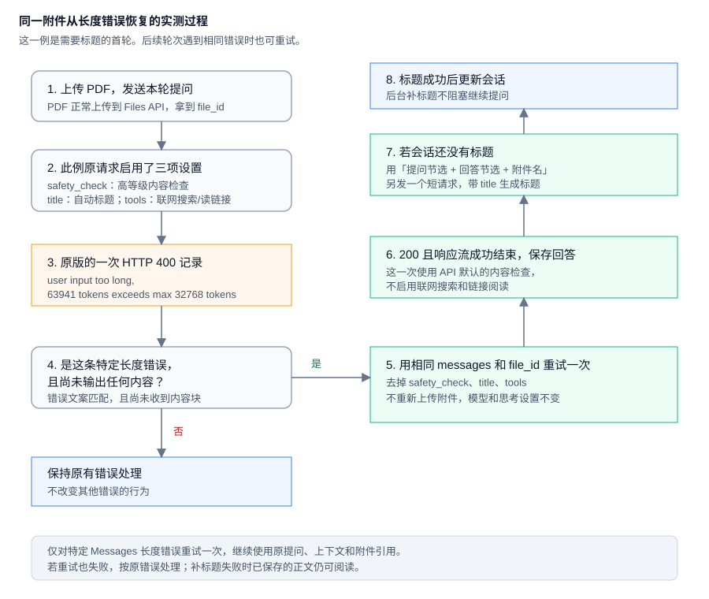

# 大 PDF：发送第一条消息时被 32k 限制拒绝

## 一句话说明

PDF 能正常上传，但发送第一条消息时，如果请求里带有 `safety_check`、`title` 或 `tools`，Messages API 会把单次输入限制在 32,768 tokens；超过后直接返回 400，用户看不到回答。

修复后只在收到这条特定错误、且还没有输出内容时，去掉这三个字段，用相同消息和附件引用重试一次；标题另发一个短请求生成。

## 背景

`chat-demo v0.1.3` 的普通聊天请求默认会带以下扩展字段：

| 字段 | 作用 |
|---|---|
| `safety_check` | 高等级内容安全检查 |
| `title` | 根据本轮内容自动生成会话标题 |
| `tools` | 联网搜索 / 读取链接 |

只要请求里包含其中任一字段，Messages API 的单次输入上限就是 **32,768 tokens**。对于大 PDF，这会让“上传已经成功”的消息仍然无法被回答。

## 最小复现

准备：

- `chat-demo v0.1.3` 的构建产物
- 本目录的 [`fixtures/dsh-dense-probe.pdf`](./fixtures/dsh-dense-probe.pdf)（42 页，文本层完整）
- 可用的 API Key

步骤：

1. 在 chat-demo 中上传 `dsh-dense-probe.pdf`，等待附件上传完成。
2. 发送第一条消息：

   ```text
   只输出附件原始印刷第 042 页的九位 Page marker。
   ```

3. 观察请求和界面：

   ```text
   POST /anthropic/v1/files      200
   POST /anthropic/v1/messages   400

   user input too long, 63941 tokens exceeds max 32768 tokens
   ```

   界面会显示输入过长/请求失败，不会出现回答。

第 042 页的 Page marker 真值为 `119932668`；[`fixtures/page-markers.json`](./fixtures/page-markers.json) 保存了逐页真值。

## 修复后的处理流程



具体规则：

1. 第一次请求仍然按原样发送，包括 `safety_check`、`title` 和 `tools`。
2. 只有同时满足以下条件才重试：
   - HTTP 400
   - 错误文案包含 `user input too long ... max 32768 tokens`
   - 本次请求还没有收到任何输出内容
3. 重试使用相同的 `messages` 和同一个附件 `file_id`：
   - 去掉 `safety_check`
   - 去掉 `title`
   - 去掉 `tools`
   - 模型、思考设置和附件引用保持不变
4. 回答成功后，如果会话还没有标题，再单独发一个短请求，内容只包含：
   - 提问节选
   - 回答节选
   - 附件名

   这个短请求带 `title`，但不带长文档，因此不会再次触发 32k 限制。

普通短消息、其他类型的错误、已经开始输出内容的请求，都不会进入这条重试路径。

## 请求序列对比

| 场景 | 请求 |
|---|---|
| 原版 `v0.1.3` | 第一次 `/messages` 400 后结束，界面报输入过长 |
| 修复后 | 第一次 `/messages` 400；第二次 `/messages` 200（去掉三个字段，复用附件引用）；标题短请求 200 |
| 普通短消息 | 仍然只发一次 `/messages`，行为不变 |

附件不会因为重试而重新上传：第一次 `POST /files` 的 `file_id` 会被第二次请求复用。

## 验证结果

测试环境使用真实 Messages / Files API：

| 检查项 | 结果 |
|---|---|
| 上传 42 页 PDF | Files API 200 |
| 原版第一次请求 | 400，`user input too long ... 32768` |
| 修复后第二次请求 | 200 |
| 第 042 页 Page marker | `119932668` |
| 随后第 014 页 Page marker | `521154191` |
| 普通短消息 | 只发送一次请求 |
| 会话标题 | 由单独的短请求生成并保存 |

验证的是“32k 错误被恢复为正常回答”。模型对每一页数字的读取仍可能受服务端文件解析差异影响，这不属于本次重试逻辑的范围。

## 取舍

重试那一次使用 API 默认的内容检查，不启用联网搜索、链接阅读和高等级安全检查；后续轮次恢复常规请求。

这是为了让大文档能够先得到回答。如果项目希望默认始终保留高等级安全检查，这项改动需要重新评估；旧内核兼容修复不依赖这个取舍，可以单独接收。

## 代码与复现材料

分支：`fix/long-document-retry`  
对比：https://github.com/YinkaiYu/chat-demo/compare/8ad7b56...7f28377

复现文件：

- [`fixtures/dsh-dense-probe.pdf`](./fixtures/dsh-dense-probe.pdf)
- [`fixtures/page-markers.json`](./fixtures/page-markers.json)
